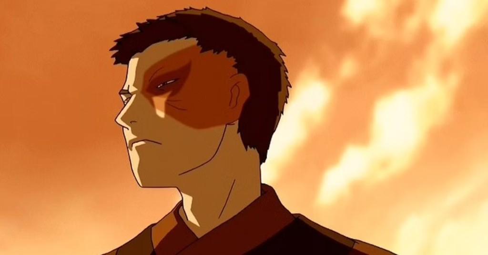

  

  

  Computer science at <b>Georgia Tech</b> · Atlanta · May 2028 
  Artificial intelligence and information internetworks 
  <a href="mailto:sduddempudi3@gatech.edu">sduddempudi3@gatech.edu</a>
  &nbsp;·&nbsp;
  <a href="https://www.linkedin.com/in/sivaduddempudi">LinkedIn</a>
  &nbsp;·&nbsp;
  <a href="https://github.com/sivaduddem">GitHub</a>

  <a href="#water"><b>Water</b></a>
  &nbsp;·&nbsp;
  <a href="#earth"><b>Earth</b></a>
  &nbsp;·&nbsp;
  <a href="#fire"><b>Fire</b></a>
  &nbsp;·&nbsp;
  <a href="#air"><b>Air</b></a>
  &nbsp;·&nbsp;
  <a href="#tea"><b>Tea</b></a>

  

**Water · machine learning.** EzMedTech voice models (Sesame CSM-1B, Llama-3), and a PyTorch platform for stuttering analysis.

  

**Earth · databases and infrastructure.** GraphMind for SQL schemas, a Kubernetes backtester, plus Neo4j, Lucene, Postgres, and Kafka.

  

**Fire · software.** Software engineer intern at Georgia Tech Research Institute. Java, Python, Go, TypeScript, C#, and a [traffic simulator](https://github.com/sivaduddem/traffic-crowd-sim).

  

**Air · cloud.** AWS at the Federal Reserve Bank of St. Louis, and Crohn's Journal on Amplify.

  

**Tea.** Tea farming, hiking, poker, travel, and Calvin and Hobbes. Alpha Kappa Psi, Data Science @ GT, RoboJackets, Startup Exchange @ GT.

  Unofficial fan profile. Avatar: The Last Airbender © Nickelodeon / Paramount. Titles set in Herculanum © Linotype. See <a href="NOTICE.md">NOTICE.md</a>.

