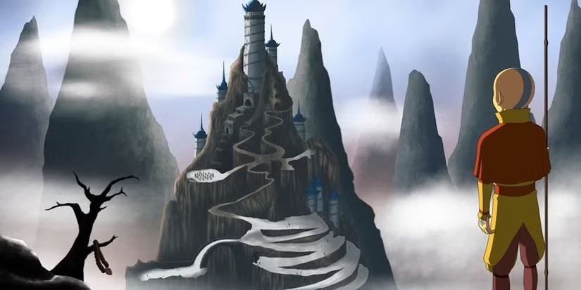
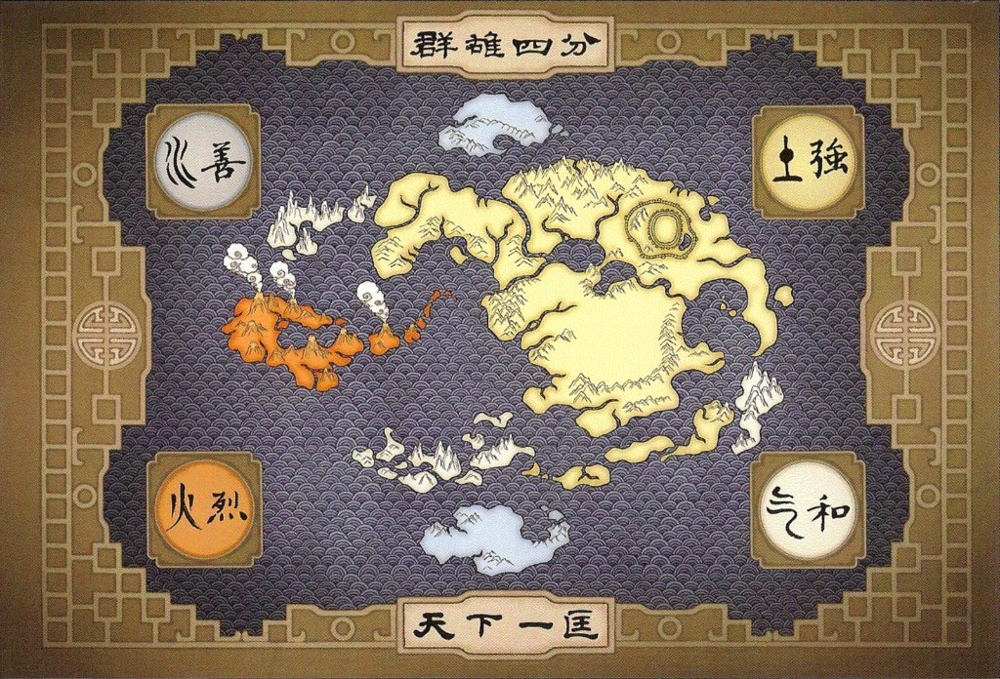
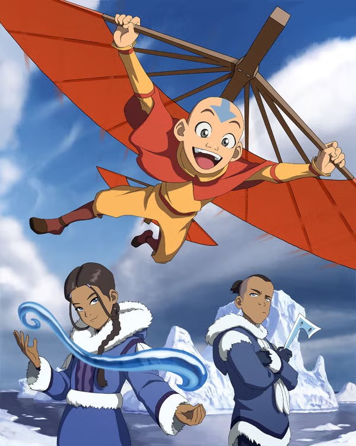
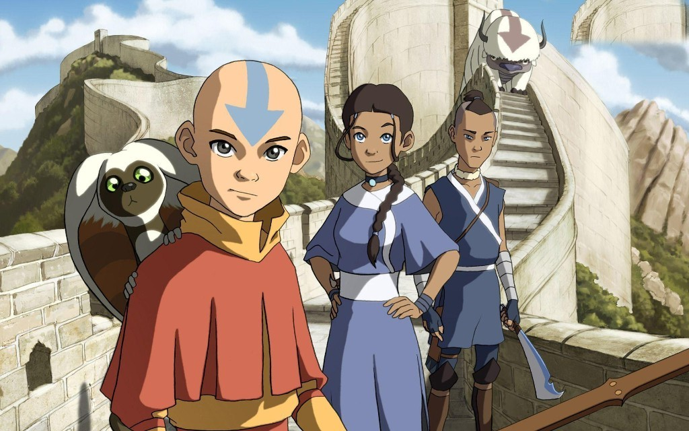
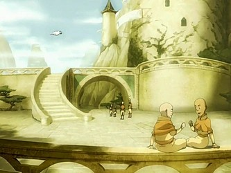
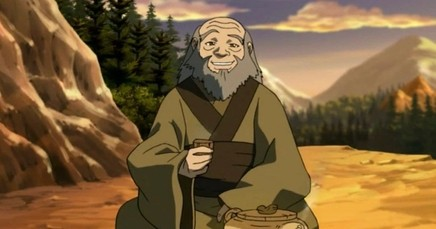

  

  

Computer science at the **Georgia Institute of Technology** in Atlanta. I graduate in May 2028, concentrating in artificial intelligence and information internetworks. The work below is the cycle I'm in: machine learning, databases, software, and cloud, learned one at a time and then together.

U.S. citizen · [sduddempudi3@gatech.edu](mailto:sduddempudi3@gatech.edu) · [LinkedIn](https://www.linkedin.com/in/sivaduddempudi) · [github.com/sivaduddem](https://github.com/sivaduddem)

Coursework so far: data structures, algorithms, databases, artificial intelligence, machine learning, statistics, operating systems, computer organization, systems and networks, discrete math.

  

  <a href="#water"><b>Water</b></a>
  &nbsp;·&nbsp;
  <a href="#earth"><b>Earth</b></a>
  &nbsp;·&nbsp;
  <a href="#fire"><b>Fire</b></a>
  &nbsp;·&nbsp;
  <a href="#air"><b>Air</b></a>
  &nbsp;·&nbsp;
  <a href="#tea"><b>Tea</b></a>

  

  

### Machine learning

**EzMedTech.AI** · Machine Learning Engineer Intern · Atlanta · August 2025 – January 2026

- Integrated Sesame's CSM-1B speech model into AI voice workflows
- Built a three-model pipeline with Mimi, split-RVQ, and Llama-3, fine-tuned on 13k voice clips, cutting evaluation loss by 0.57 and 12%
- Shipped a Bland.ai streaming path that cut latency 30% and added Spanish on live calls
- Stress-tested the agents with 40+ fault-injection cases

**Personalized Stuttering Analysis Platform** · April 2026 – present · PyTorch, Whisper, MediaPipe, FastAPI, React

A multimodal platform used by 650+ people to study 2,100+ hours of speech. Transformers trained on 15,000+ synchronized events raised stuttering-event F1 by 24%, with personalized feedback under 200 ms.

  

  

  

### Databases and infrastructure

**GraphMind** · December 2025 – March 2026 · FastAPI, NetworkX, D3.js, PostgreSQL

A data-to-graph explorer for CSV and SQL. Impact analysis and critical-table detection cut schema reading time by about half. The line-by-line SQL stepper has been used by 500+ students.

**Distributed cryptocurrency backtesting engine** · January 2025 – February 2025 · Kubernetes, Kafka, Prometheus

25,000+ simulations on autoscaling workers. Partitioning the sweeps through Kafka raised throughput 6×, cut job time 72%, and scaled past 100 pods with horizontal pod autoscaling.

The same ground shows up in the research work: Neo4j, Lucene, Elasticsearch, and SQL, on Docker, Kubernetes, Terraform, Ansible, Jenkins, and GitHub Actions.

  

  

### Software engineering

**Georgia Tech Research Institute** · Software Engineer Intern · Atlanta · June 2026 – December 2026

- Semantic retrieval over 12.9K+ user actions with EmbeddingGemma-300M, Lucene HNSW, and cosine similarity
- A Neo4j graph of users, actions, topics, and the relationships used for threat search
- HDBSCAN pipelines that turn embeddings into hierarchical topic topologies
- Sub-second analyst queries after tuning HNSW, Neo4j traversals, and the React views

**Traffic and crowd simulator** · August 2025 – September 2025 · C# / .NET · [sivaduddem/traffic-crowd-sim](https://github.com/sivaduddem/traffic-crowd-sim)

Discrete-event agents on a shared road network. Congestion control raised route completions about 25% per timestep. The useful part was the tipping point, where p95 travel time breaks as density climbs.

I write Java, Python, Go, C, C++, C#, JavaScript, TypeScript, Rust, SQL, and also R, Assembly, and PowerShell.

  

  

### Cloud computing

**Federal Reserve Bank of St. Louis** · Software Engineer Intern · June 2025 – August 2025

- An AWS pipeline that replaced manual CVE tracking for 12+ Treasury teams
- A TypeScript CDK stack: Lambda, SQS, S3, EventBridge, and CodePipeline
- A front end on API Gateway, with KMS and DynamoDB backing OTP auth for 200+ users
- Agile delivery in Jira and Confluence

**Crohn's Journal** · July 2022 – present · React, AWS Amplify, SCSS

A personal health journal I started after a Crohn's diagnosis: recipes and practical advice, now past 5,000 active users in 20+ countries. Custom theme on Amplify, about 40% better retention, with SEO and analytics on the growth.

The rest of the sky I work in: Lambda, S3, DynamoDB, SQS, EventBridge, API Gateway, CloudWatch, SNS, KMS, Bedrock, CDK, and CodePipeline.

  

  

### Off the clock

Tea farming is a real interest. So are hiking, poker, travel, finance, healthcare, and big data. I read Calvin and Hobbes, and I will talk about Batman for longer than a standup can survive.

On campus: Alpha Kappa Psi, Data Science @ GT, RoboJackets, and Startup Exchange @ GT.

---

  Unofficial fan profile. Avatar: The Last Airbender is © Nickelodeon / Paramount. Titles are set in Herculanum, © Linotype. Not affiliated or endorsed. See <a href="NOTICE.md">NOTICE.md</a> before treating this as cleared to publish.

